信通学院电子信息工程专业 “智能硬件系统课程设计”任务书

| 题目 | 智能硬件系统IOT应用开发 |  |  |
| --- | --- | --- | --- |
| 主要<br>内容 | 学习和掌握构建基于智能硬件平台和嵌入式 Linux 软件开发环境的方法，掌握物联网平台原理和接入方法，配置设备联网实现某种云平台的设备接入和MQTT数据通信，实现本地传感器数据上报和设备远程控制等功能。 |
| 设计<br>要求 | 基本要求：某种云平台的设备接入或者本地MQTT服务器接入，智能硬件平台上实现传感器数据上报和远程控制。<br>扩展部分：图形环境下，设计图形应用程序实现设备和云平台数据交互。 |
| 主要<br>仪器<br>设备 | 1、 智能硬件开发系统 1 套<br>2、 计算机 1 台，安装Ubuntu操作系统及 arm-linux 交叉编译工具<br>3、 网线 2 根，IP 地址 2 个 |
| 课程设计开始日期 | 1周 | 课程设计完成日期 | 5周 |
| 课程设计实验室名称 | 电子信息技术实验室 | 地点 | XXA-404 |
| 课程设计专题网站 | 无 | 资料和软件<br>下载地址 | 学习通 |

*课程设计进度计划（起止时间、工作内容）*

*第 1-2 周 掌握构建嵌入式 Linux 开发环境及开发应用程序的基本方法；理解所选题目要求，学习相关知识，搭建相应软件和硬件环境；完成基本要求，完成云平台设备接入和数据上报。<br>第 3-4 周 进一步完善功能，并进行扩展要求设计，完成课程设计报告，现场检查、答辩。<br>课程设计期间的其它时间实验室也一直开放，需要实验的同学在遵守实验室管理规定的条件下可以随时进行实验。课程设计报告在课程设计答辩时提交。*

## 目录

- 一、 课设内容

  - 1． 实验内容

  - 2． 实验要求

  - 3． 实验仪器

- 二、 系统设计

  - 1． 系统总体架构

  - 2． 硬件架构

  - 3． 软件架构

- 三、 环境搭建

  - 1． 虚拟机环境配置

    - 1.1. 虚拟机配置

    - 1.2. 网络配置

    - 1.3. NFS服务配置

    - 1.4. MQTT broker配置

  - 2． 实验箱配置

- 四、 设备端软件实现

  - 1． 设备端软件总体架构

  - 2． 设备控制实现

    - 2.1. DHT11温湿度采集实现

    - 2.2. LED灯珠控制实现

    - 2.3. LCD显示屏控制实现

    - 2.4. 舵机控制实现

  - 3． MQTT客户端

    - 3.1. 启动客户端

    - 3.2. 发布采集数据

    - 3.3. 回调

- 五、 Broker端实现

  - 1． Broker数据结构

    - 1.1. 客户连接表

    - 1.2. 主题订阅反索引表

  - 2． 数据流

    - 2.1. 上行数据

    - 2.2. 下行数据

- 六、 控制端软件实现

  - 1． 控制端软件总体架构

    - 1.1. 主要功能

    - 1.2. 模块划分

  - 2． 控制端软件UI设计

  - 3． MQTT通信实现

- 七、 课设效果

  - 1． DHT11温湿度采集

  - 2． LED灯珠控制

  - 3． LCD显示屏控制

  - 4． 舵机控制

- 八、 总结

- 九、 附录

  - 1． 程序源码

    - 1.1. 设备端软件

    - 1.2. 控制端软件

智能硬件系统IOT应用开发

# 一、课设内容

## 1．实验内容

1. 学习和掌握构建基于智能硬件平台和嵌入式Linux软件开发环境的方法。

2. 掌握物联网平台原理和接入方法。

3. 配置设备联网实现某种云平台的设备接入和MQTT数据通信，实现本地传感器数据上报和设备远程控制等功能。

## 2．实验要求

1. 基本要求：某种云平台的设备接入或者本地MQTT服务器接入，智能硬件平台上实现传感器数据上报和远程控制。

2. 扩展部分：图形环境下，设计图形应用程序实现设备和云平台数据交互。

## 3．实验仪器

| 智能硬件开发系统1套 | 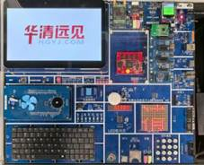 |
| --- | --- |
| 计算机1台，安装Ubuntu操作系统 及arm-linux交叉编译工具 | 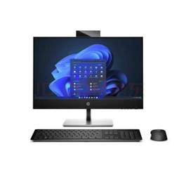 |
| 网线2根，IP地址2个 | 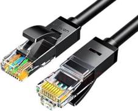 |

*主要仪器设备*

# 二、系统设计

## 1．系统总体架构

本次实验的目标是利用智能硬件系统开发一套物联网应用。整套物联网系统主要由硬件和软件两部分组成。

在硬件层面，我们使用华清远见FS_EMB6818实验箱作为系统的感知与执行设备，使用实验室的电脑作为控制端设备，二者通过网线和串口进行数据传输。

而在软件层面，我们使用MQTT协议来实现系统内的通信。我们在实验室的电脑上部署了broker MQTT服务器，并使用它来作为数据传输的中转站。实验箱和电脑分别部署了设备端软件和控制端软件，二者之间相互配合，从而实现了智能硬件平台上实现传感器数据上报和远程控制。

系统总体架构图如下图所示。

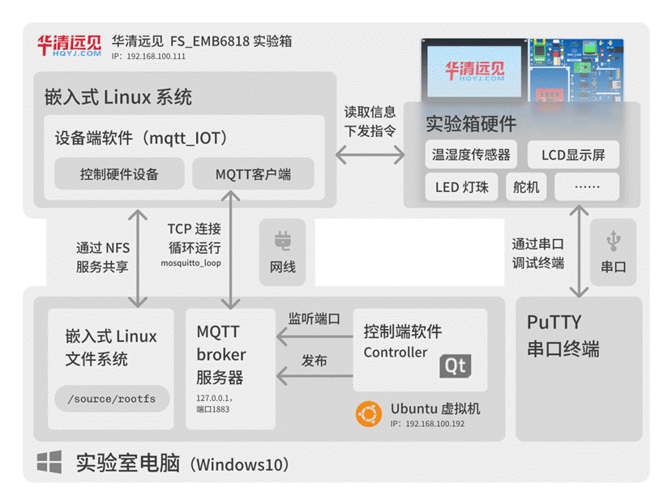

*图2.1.1 系统总体架构图*

## 2．硬件架构

如前文所述，我们的硬件设备主要包含华清远见FS_EMB6818实验箱与实验室的电脑。其中实验箱由搭载三星S5P6818 ARM（8核Cortex-A53）处理器的核心板和囊括各类功能的底板组成，其规格如下图所示：

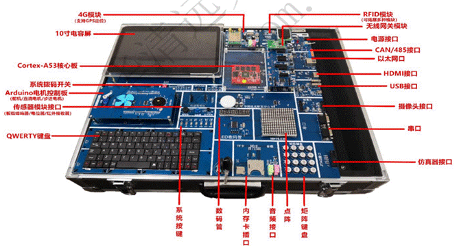

*图2.2.1 华清远见FS_EMB6818实验箱*

而实验室电脑型号为惠普ProOne 600 G4，内置1000Mbps以太网卡，同时支持连接多个USB 串行设备，因此可以与实验箱组建局域网，并通过串口对实验箱进行调试。

系统硬件架构如下图所示。

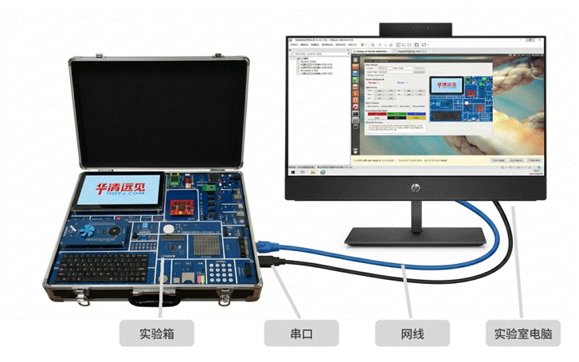

*图2.2.2 硬件架构图*

## 3．软件架构

我们的物联网系统的软件部分较为复杂，整个系统内共有3个操作系统，分别是运行在实验室电脑上的Windows10操作系统，实验室电脑上的Ubuntu 12.04虚拟机以及实验箱的嵌入式Linux系统（内核版本3.4.39）。

实验室电脑上的Windows10操作系统主要作用是运行PuTTY串口调试软件，用于操作实验箱的终端，同时作为宿主机运行Ubuntu虚拟机。

Ubuntu 12.04虚拟机具有诸多作用。首先，它运行着MQTT broker服务器，是整个系统数据传输的中转站；其次，它运行着NFS服务，并桥接了实验室电脑的以太网卡，对外导出 /source/rootfs 路径，实验箱的文件系统需要从此挂载；最后，它还是整个系统的控制端，运行着基于Qt开发的图形化控制端软件。

实验箱的嵌入式Linux操作系统的作用也至关重要。首先，作为实验箱上的操作系统，它需要管理实验箱上的硬件设备，例如加载/卸载驱动等；其次，它也运行着设备端软件，需要向Broker服务器发送采集数据，接收来自服务器的控制指令。

系统软件架构如下图所示。

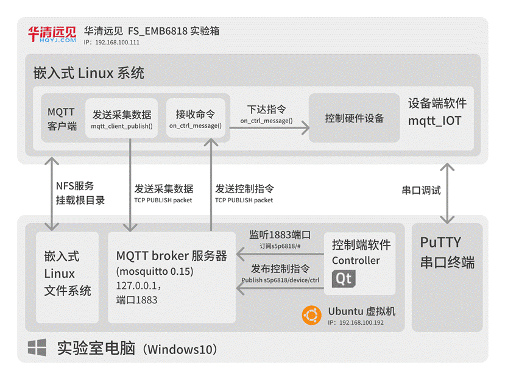

*图2.3.1 软件架构图*

# 三、环境搭建

## 1．虚拟机环境配置

### 1.1. 虚拟机配置

我们采用华清远见提供的基于Ubuntu 12.04 64-bit的开发环境作为虚拟机的原始镜像。虚拟机中已经预置了arm-none-linux-gnueabi 4.3.2、4.4.6、4.5.1交叉工具链，并安装了Vim、Ctags、Vim补全插件等软件。

我们为虚拟机分配了2核处理器，4096 MB内存以及80GB磁盘空间，同时将虚拟机的网络适配器工作模式调整为以桥接模式，确保虚拟机能直接使用以太网卡，并与同一局域网内的实验箱直接通信。

### 1.2. 网络配置

如前文所述，我们的虚拟机与实验箱处于同一局域网内，为了简化二者之间的通信，我们需要将虚拟机的IP地址设为固定值。

这里我们将IP固定为了192.168.100.192，其配置（/etc/network/interface）如下所示。

```text
auto lo
iface lo inet loopback
auto eth0
iface eth0 inet static # 设置静态IP
address 192.168.100.192# # IP地址
netmask 255.255.255.0
gateway 192.168.100.2
network 192.168.100.0
broadcast 192.168.100.255
dns-nameservers 192.168.100.2
```

### 1.3. NFS服务配置

配置好网络后，我们就可以配置NFS服务了。

在这之前，我们已经在虚拟机的根目录上创建了 /source/rootfs 目录，并将实验箱所需的完整的Linux系统安装到了这一目录。为了让实验箱能把文件系统挂载到这一目录，我们需要启动Ubuntu开发环境中的nfs-kernel-server，并将目录设为共享目录，其配置（etc/exports）如下所示。

```text
/source/rootfs *(rw,sync,no_root_squash,no_subtree_check)
```

保存配置后，我们将NFS服务设为开机自启动，并关闭防火墙，这样就配置好NFS服务了。我们可以输入showmount -e 127.0.0.1命令来检查。

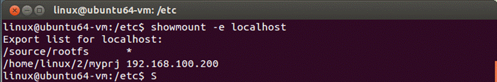

*图3.1.3 NFS服务状态*

### 1.4. MQTT broker配置

配置好网络和NFS服务后，实验箱就能从虚拟机根目录中的 /source/rootfs 中挂载文件系统了。接下来我们还需要构建二者之间的通信链路，从而实现实验箱采集数据的上传与控制端控制指令的下发。

我们选用了MQTT协议作为通信协议，并在Ubuntu虚拟机内部署MQTT Broker服务器。我们使用mosquitto作为broker主程序，同样将其设置为开机自启动，并对其进行配置（/etc/mosquitto/mosquitto.conf）。

```conf
persistence true     # 启动持久化
persistence_location /var/lib/mosquitto/ # 保存数据
log_dest none   # 关闭日志
```

这样，Mosquitto会默认工作在虚拟机本地的1883端口（默认值），客户端也就能收到broker转发的数据，并向broker发送数据，至此MQTT broker配置完毕。

## 2．实验箱配置

虚拟机全部配置就绪后，我们只需要更改实验箱的bootloader参数，设置实验箱IP，并设置NFS启动，即可完成实验箱的配置。

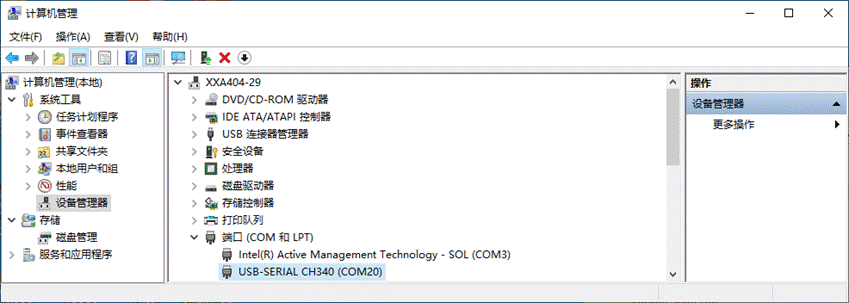

*图3.2.1 实验箱串口端号*

我们已经为实验箱连接5V电源线供电，并通过网线与串口将实验箱与实验室电脑进行连接。确定的实验箱连接的串口端号（COM20）后，我们在PuTTY串口调试工具中按指定连接类型输入指定COM号和波特率，即可操作实验箱的终端控制台。

|  |  |
| --- | --- |
| 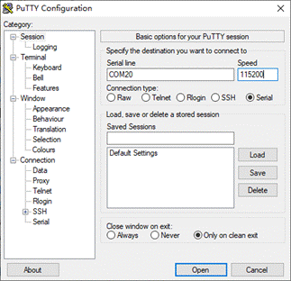 | 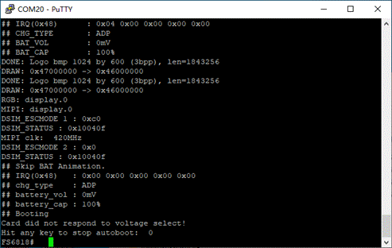 |

*图3.2.2 操作实验箱终端*

我们进入实验箱的Uboot bootloader菜单，设置以下参数：

```text
# NFS启动linux
setenv bootcmd ext4load mmc 2:1 0x48000000 uImage\;bootm 0x48000000
setenv bootargs root=/dev/nfs nfsroot=192.168.100.192:/source/rootfs,proto=tcp console=ttySAC0,115200 init=/linuxrc ip=192.168.100.111:::::eth0:off
```

保存参数后，我们令实验箱启动，即可让实验箱挂载虚拟机的 /source/rootfs 目录并进入嵌入式Linux操作系统。至此我们完成了实验箱的所有配置。

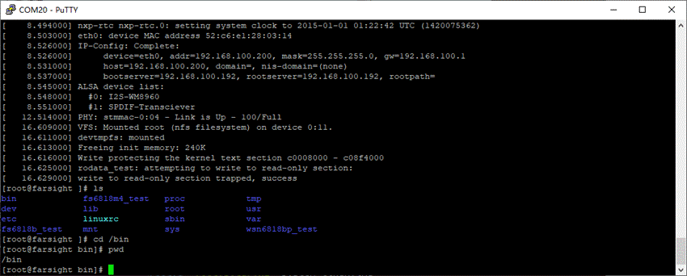

*图3.2.3 实验箱启动系统*

# 四、设备端软件实现

在上一章节，我们已经完成了所有环境的配置，接下来我们就可以正式进入开发环节了。

## 1．设备端软件总体架构

我们的设备端软件运行于实验箱上，主要功能包含发送采集数据、接收控制命令和控制实验箱设备。我们将设备端软件命名为mqtt_iot，并使用C语言对其进行开发，软件总体架构如下所示。

```text
mqtt_iot/
├── main.c   # 入口、信号处理、外设初始化、命令分发
├── mqtt_client.c  # libmosquitto 0.15 封装(连接/订阅/发布/回调)
├── dht11.c  # DHT11 温湿度传感器
├── led.c  # 4 颗 LED 灯
├── lcd.c  # LCD 全屏颜色填充
├── servo.c  # 舵机角度控制
└── beep.c  # 蜂鸣器(预留)
```

整个设备端软件包含三个线程，分别是主线程、MQTT loop线程与DHT11数据线程。

其中主线程负责处理信号、初始化设备，启动MQTT客户端以及创建DHT11线程；MQTT loop线程是唯一与网络打交道的线程，每100 ms轮询一次，负责MQTT通信；而DHT11线程则只负责读取温度传感器（dht11），每5秒执行一次，并推到broker服务器。

## 2．设备控制实现

### 2.1. DHT11温湿度采集实现

DHT11是一款数字温湿度传感器，使用单总线协议与MCU通信。传感器单总线协议时序由内核空间的DHT11驱动完成，我们在开发时只需open()设备节点 + read() 4字节即可获得结果。

拿到结果后，我们还需要对结果进行解析，并将温湿度信息以JSON格式publish到broker服务端，从而完成DHT11线程的完整循环。其主要代码片段如下所示：

```cpp
// 1. 打开设备节点
fd = open("/dev/dht11", O_RDWR);
// 2. 读 4 字节(驱动内部完成单线协议时序,阻塞 100~200 ms)
unsigned char buf[4] = {0};
read(fd, buf, sizeof(buf));
// 3. 按驱动返回的字节序解析(buf[0]=湿度小数, buf[1]=温度整数,
//  buf[2]=温度小数, buf[3]=校验和)
int humi_dec = buf[0];
int temp_int = buf[1];
int temp_dec = buf[2];
// 4. 拼 JSON,publish 到 broker
char json[96];
snprintf(json, sizeof(json),
"{\"hum\":%d,\"temperature\":%d}", humi_int, temp_int);
mqtt_client_publish("s5p6818/env/data", json, strlen(json), 0);
```

### 2.2. LED灯珠控制实现

我们的实验箱上共有4颗LED灯珠，硬件接口位于操作系统的/sys/class/leds/led{1..4}/brightness路径。brightness接受0或1作为LED灯珠的控制开关，因此直接write(fd, "0", 1) 或write(fd, "1", 1) 即可控制灯珠。

需要注意的是，实验箱的LED逻辑较为特殊，写0灯亮，写1灯灭。因此需要对代码进行对调。

```text
const char *v = on ? "0" : "1"; // 板子反相:on=1 时写 0 才亮
```

### 2.3. LCD显示屏控制实现

我们的实验箱上的LCD显示屏采用Linux framebuffer设备(/dev/fb0)，通过mmap()将显存映射到用户态后,可像访问普通内存一样直接对像素进行读写。

LCD显示屏的分辨率为1024×600，我们定义了红、绿、蓝、白、黑、黄共6种颜色，lcd_fill_named() 字符串查表后调lcd_fill_screen() 即可全屏填色。

```cpp
int lcd_init(void) {
g_fbfd = open(LCD_FB_PATH, O_RDWR);  // 打开 framebuffer 设备 /dev/fb0
ioctl(g_fbfd, FBIOGET_VSCREENINFO, &g_vinfo); // 获取屏幕参数
g_screensize = g_vinfo.xres * g_vinfo.yres * 4; // 计算显存大小
g_fbp = mmap(0, g_screensize, PROT_READ | PROT_WRITE, MAP_SHARED, g_fbfd, 0);  // 显存映射到用户态
}
void lcd_fill_screen(color_t color) {
for (y = 0; y < g_vinfo.yres; y++) {  // 双循环逐像素写
for (x = 0; x < g_vinfo.xres; x++) {
location = (x + g_vinfo.xoffset) * 4 + (y + g_vinfo.yoffset) * g_finfo.line_length;
*((unsigned long *)(g_fbp + location)) = color;
}
}
}
```

### 2.4. 舵机控制实现

我们实验箱上的舵机使用字符设备接口(/dev/servo)，通过ioctl() 下发控制命令。舵机的驱动由厂方实现，出厂镜像已内置。

通过servo_goto(slot) 可调整舵机至5档预设角度，通过servo_set_angle(angle) 则可控制舵机调至0~180°任意角度。

```cpp
g_fd = open(SERVO_DEV_PATH, O_RDWR); // 打开 /dev/servo
void servo_goto(int slot) {  // 预设角度(0/45/90/135/180)
ioctl(g_fd, _IO('S', slot), 0); // 魔数 'S',命令编号 slot
}
void servo_set_angle(int angle) { // 任意角度(0~180)
if (angle < 0) angle = 0;
if (angle > 180) angle = 180;
ioctl(g_fd, _IO('S', 5), angle); // 魔数 'S',编号 5 = SET_ANGLE
}
```

## 3．MQTT客户端

如前文所述，我们的设备端软件主要功能包含发送和接收数据，而数据的传入与传出需要一个中转站，因此我们在设备端软件的mqtt_client.c中封装了libmosquitto 0.15客户端，负责与VM上的broker通信。这样所有传感器数据从这里出去，所有控制命令从这里进来了。

### 3.1. 启动客户端

设备端软件启动时会启动主线程，MQTT客户端也会随之启动。在启动阶段，mqtt_client_start()会先初始化mosquitto lib，随后创建客户端并注册回调，发起TCP连接，最后启动后台MQTT loop线程。核心代码片段如下：

```cpp
mosquitto_lib_init();  // 初始化 lib
g_mosq = mosquitto_new(MQTT_CLIENT_ID, NULL); // 创建客户端
mosquitto_connect_callback_set(g_mosq, on_connect); // 注册回调
mosquitto_connect(g_mosq, g_host, MQTT_PORT,
MQTT_KEEPALIVE, MQTT_CLEAN_SESSION);// 发起 TCP 连接
pthread_create(&tid, NULL, loop_thread_fn, NULL);  // 启后台 loop 线程
```

TCP连接建立后的MQTT服务由libmosquitto维护，因此所有收发直接走mosquitto_publish和mosquitto_loop库函数就可以了。

### 3.2. 发布采集数据

在DHT11线程中，设备端软件在采集到温湿度数据后，需要把数据传到broker上。这一步由DHT11线程调用mqtt_client_publish()完成，每5秒调用一次。在publish内部，mosquitto_publish会把数据放入libmosquitto的内部发送队列，并由后台loop线程在下一轮mosquitto_loop()里发出。核心代码片段如下:

```cpp
int mqtt_client_publish(const char *topic, const char *payload,
int payload_len, int qos) {
return mosquitto_publish(g_mosq, NULL, topic, payload_len,
(const void *)payload, qos, false);
}
```

### 3.3. 回调

我们封装的libmosquitto在loop线程里检测到网络事件时，会触发回调函数。我们注册了3个回调，分别处理连接成功、收到消息和连接断开事件。

on_connect函数在TCP连接建立成功后被触发，内部完成对控制主题s5p6818/device/ctrl的订阅；on_message在收到broker转发的PUBLISH时被触发，把payload复制成字符串后调用on_ctrl_message()分发到具体设备；而on_disconnect则在TCP连接断开时被触发，仅打印日志，重连由libmosquitto内部自动处理。

至此，MQTT客户端的连接、发布、回调3个环节形成了一个完整的闭环：DHT11线程通过publish把传感器数据送出去，broker转发给Controller订阅者；Controller通过publish下发控制命令，broker再转发回设备，最后on_message接收后交给on_ctrl_message分发到硬件。整个流程如下图所示。

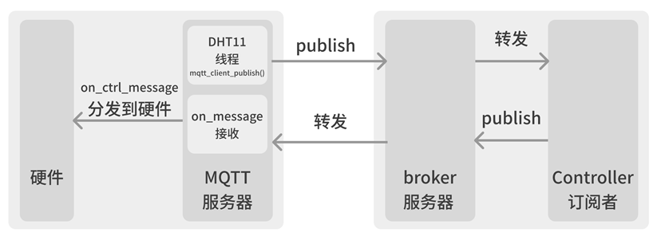

*图4.3.3 MQTT客户端流程*

# 五、Broker端实现

在成功实现设备端软件后，我们接下来就可以搭建Broker服务器了。我们已经在设备端软件中封装了Mosquitto 0.15，因此我们的服务端也会采用Mosquitto 0.15。

在前文第三章1.4节 MQTT broker配置章节中，我们已对Mosquitto的安装和参数进行了详细的介绍，因此这里不再重复赘述，仅对服务端内的数据结构和数据流进行阐述。

## 1．Broker数据结构

### 1.1. 客户连接表

Broker服务器的客户链接表上有两个client_id，分别是fs6818_mqtt_iot和Controller。前者代表的是实验箱，其TCP socket为TCP to 192.168.100.111，也就是实验箱在局域网内的IP地址；订阅列表为s5p6818/device/ctrl，也就是控制端下发指令的topic。

而后者则代表的是控制端软件。其TCP socket为TCP to 192.168.100.x，订阅列表为s5p6818/#，也就是实验箱发来的DHT11传感器的温湿度数据。

| client_id | TCP socket | 订阅列表 |
| --- | --- | --- |
| fs6818_mqtt_iot | TCP to 192.168.100.111 | s5p6818/device/ctrl |
| Controller | TCP to 192.168.100.x | s5p6818/# |

*表5.1.1 客户连接表*

### 1.2. 主题订阅反索引表

主题订阅反索引表以主题模式为键，值为订阅者列表。broker收到PUBLISH时直接查表就能找出所有订阅者。反索引的维护在SUBSCRIBE / UNSUBSCRIBE报文到达时动态更新。

| 主题模式 | 订阅者（client_id）列表 |
| --- | --- |
| s5p6818/# | Controller |
| s5p6818/device/ctrl | fs6818_mqtt_iot |

*表5.1.2 主题映射反索引表*

## 2．数据流

我们的broker服务器的数据流按方向分为两路:温湿度上行(设备→broker→Controller)和控制指令下行(Controller→broker→设备)。

### 2.1. 上行数据

上行数据传输流程主要包括实验箱传输数据、broker服务器转发数据、以及Controller控制端接收数据。实验箱上传输数据的流程我们在前文中已经详细介绍，Controller控制端接收数据的流程我们将在后文进行介绍，因此这里着重阐述broker服务器上的数据流。

我们的broker客户端收到来自实验箱的PUBLISH报文后，会先解析报文头，提取主题字段(s5p6818/env/data)和payload字段(JSON格式的温湿度数据)。然后broker会在自己的反索引表中查找订阅者，并对订阅者的TCP socket发起一次 PUBLISH报文转发。

在我们的实验中，Controller控制端的QtMqtt客户端在收到这条转发报文后，会通过信号槽机制通知上层UI组件，最后UI更新温湿度label显示。至此整个上行数据流的全部流程就全部完成了。

### 2.2. 下行数据

下行数据传输流程与上行类似，但方向相反，主要包括控制端传输指令、broker服务器转发指令、以及设备端接收并执行指令。控制端发送指令的流程将在后文介绍，设备端接收指令并执行的流程我们在前文也已经详细介绍，这里同样着重阐述broker服务器上的数据流。

当Controller程序把用户点击按钮对应的字符串（以lcd_red为例）包装成PUBLISH报文发到broker后，broker会先解析报文头，提取主题字段s5p6818/device/ctrl。随后，broker在反索引表中查找这个主题的订阅者（实验箱），并对实验箱的TCP socket发起一次PUBLISH报文转发。

实验箱mqtt_iot的loop线程在mosquitto_loop(100)中收到这条报文，触发on_message回调，回调里把payload复制为字符串后调on_ctrl_message()分发到具体硬件设备，LCD屏变红。至此整个下行数据流的全部流程就全部完成了。

# 六、控制端软件实现

在前面三章中，我们先后完成了实验箱端mqtt_iot客户端、VM端Mosquitto broker的实现，构建了从传感器到broker的上行数据通路。接下来我们就要深入控制端软件Controller了。

由于Ubuntu 12.04系统自带Qt 4.8源码兼容，因此我们选用Qt 4.8作为GUI框架。

## 1．控制端软件总体架构

### 1.1. 主要功能

作为控制端软件，Controller主要有两个功能，一是订阅s5p6818/#主题，接收broker转发的温湿度数据，显示在UI label上；二是发布到s5p6818/device/ctrl主题，把用户点按钮产生的字符串命令(如led_on、servo_90)推给broker，由broker转发给设备。

与设备端软件相比，控制端软件Controller功能非常简单，它无需接触任何硬件相关代码，也无需libmosquitto等库，所有与broker的交互都被封装在独立的MqttProcess类里，主窗口只需关心"按哪个按钮发什么字符串"即可。

### 1.2. 模块划分

控制端软件Controller共有4个源文件，分别是main.cpp、MainWindow.h/.cpp、MqttProcess.h/.cpp以及FarSightWidget.h/.cpp。各个源文件的功能如下表所述：

| 文件 | 功能 |
| --- | --- |
| main.cpp | QApplication 入口，设置应用名，创建并显示主窗口，进入 Qt 事件循环 |
| MainWindow.h/.cpp | 主窗口 UI 搭建，所有按钮的槽函数，MQTT 消息分发到 UI 更新 |
| MqttProcess.h/.cpp | 用 QProcess 包装 mosquitto_pub/sub 命令行调用 |
| FarSightWidget.h/.cpp | 实验箱仿真器，可实时预览做出的更改 |

*表6.1.2 模块划分*

这些文件的依赖是单向的，main.cpp启动 MainWindow，MainWindow 持有 MqttProcess 实例(发命令) + FarSightWidget 实例(可视化)，MqttProcess 通过信号槽与 MainWindow 通信。整个软件由"一个主窗口 + 一个通信类 + 一个可视化控件"组成。

## 2．控制端软件UI设计

我们的控制端应用的主窗口采用采用左右分栏的经典Qt布局方式，通过QSplitter实现水平分割，整体效果如下图所示。

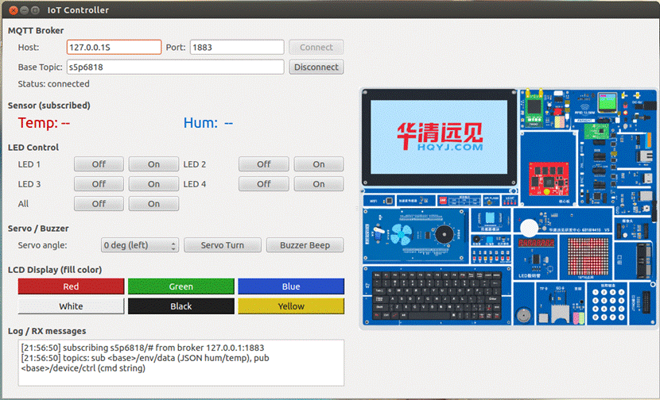

*图6.2.1 主窗口布局*

窗口的左栏从上到下有6个GroupBox，从上到下依次为MQTT Broker连接区、Sensor数据显示区、LED控制区、Servo / Buzzer区、LCD颜色区以及Log / RX消息区；而窗口的右侧是实验箱的仿真器，可通过仿真器实时预览LCD屏幕显示内容。

## 3．MQTT通信实现

如前文所述，我们的控制端软件没有引入QtMqtt等C客户端库，而是让QProcess 调 mosquitto_pub / mosquitto_sub 两个命令行工具。QProcess 是 Qt 自带的进程管理类，在 Qt 4.8 上无需额外依赖。

具体来说，我们的MqttProcess类对两种MQTT操作做了不同处理。发布操作每次临时启动一个mosquitto_pub进程，发完即结束；订阅操作则启动一个长生命周期的mosquitto_sub进程，持续把收到的消息按行拆出topic与payload，再通过信号把payload送到MainWindow。

虽然后续版本的Qt支持直接调用QtMqtt库来完成这些功能，但是它们并不适配于Ubuntu 12.04系统。因此我们只能选择调用外部工具，而不能封装具有指定功能的库到控制端应用中。

# 七、课设效果

在前面的四个章节中，我们先后完成了实验箱端mqtt_iot客户端、VM端Mosquitto broker的实现，broker服务器搭建以及Controller控制端构建。整个系统搭建完毕后，我们就可以让整个系统运行起来了！

## 1．DHT11温湿度采集

我们的实验箱上有一个 DHT11 数字温湿度传感器。系统启动后，我们就可以在控制端软件上查看实验箱的温湿度数据了。

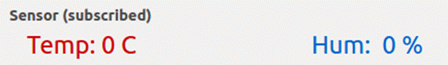

*图 7.1.1 控制端选项*

控制端软件的选项如上图所示。在"Sensor (subscribed)"区域有两个大字体 label，红色"Temp: "显示温度，蓝色"Hum: "显示湿度，每 5 秒会刷新一次，数据来自实验箱 DHT11 传感器实时采集。

由于实验箱温湿度传感器损坏，因此只会返回“0”作为温度值，应用端软件s5p6818/env/data -v订阅都温湿度信息也因此为“0”。PuTTY终端日志如下所示。

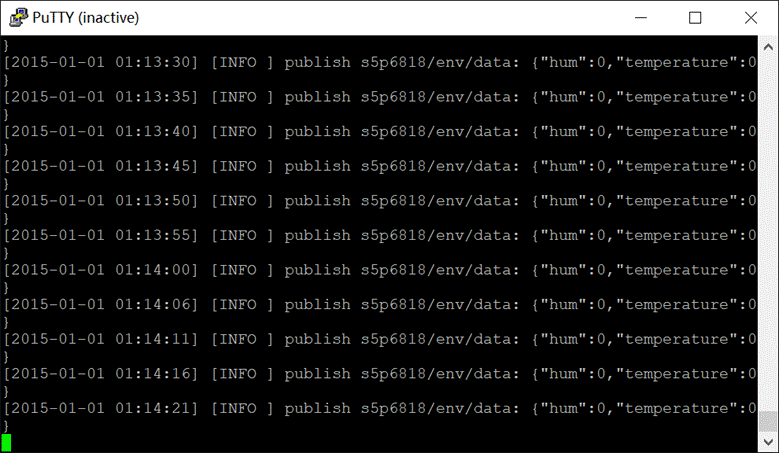

*图7.1.2 PuTTY终端日志*

## 2．LED灯珠控制

我们的实验箱上共有4颗LED灯珠。系统启动后，我们就可以在控制端软件上管理这4颗灯珠了。

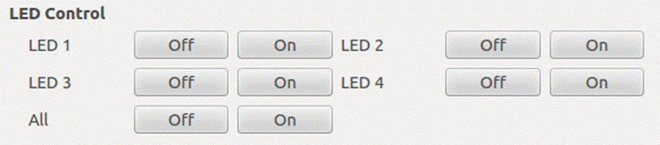

*图7.2.1 控制端选项*

控制端软件的选项如上图所示。我们既可以对4个灯珠依次分别关闭，也可以直接关闭所有灯珠。

为了便于测试，我们先依次点击界面上4个LED灯的“On”按钮让灯亮起，再点击“All”选项的“Off”按钮关闭所有灯，控制指令通过控制端软件发布至Broker服务器，随后转发至实验箱，实验箱收到指令后在终端上打印日志，并操作灯珠开启/关闭。操作结果和PuTTY终端日志如下所示。

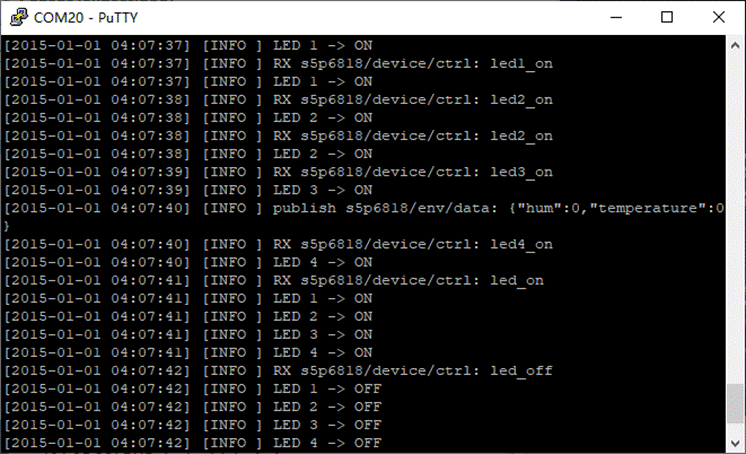

*图7.2.2 PuTTY终端日志*

| 执行“On”后 | 执行“Off”后 |
| --- | --- |
| 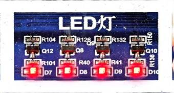 | 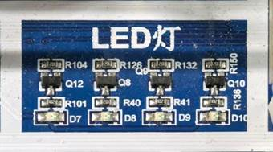 |

*图7.2.3 LED灯珠变化*

## 3．LCD显示屏控制

我们的实验箱上有一块 1024×600、32 bpp 的 LCD 显示屏。系统启动后，我们就可以在控制端软件上对 LCD 进行全屏颜色填充了。

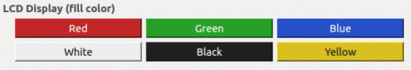

*图7.3.1 控制端选项*

控制端软件的选项如上图所示。我们既可以点击 6 个不同颜色的 LCD 颜色按钮(红 / 绿 / 蓝 / 白 / 黑 / 黄)，也可以在右栏的 FarSightWidget 中预览 LCD 实际会显示什么颜色。

我们依次点击界面上 6 个 LCD 颜色按钮让屏幕依次变为对应颜色，控制指令通过控制端软件发布至 Broker 服务器，随后转发至实验箱，实验箱收到指令后在终端上打印日志，并操作 LCD 全屏填充对应颜色。操作结果和 PuTTY 终端日志如下所示。

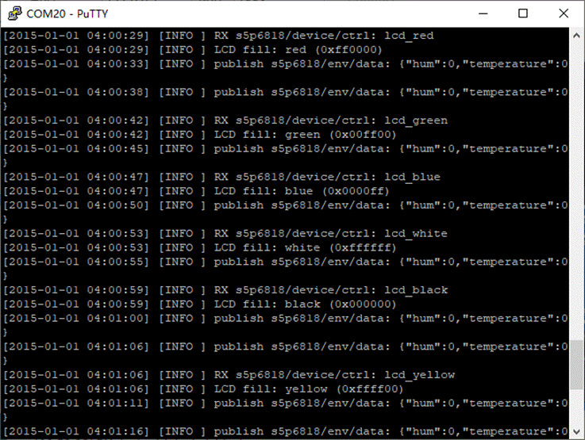

*图7.3.2 PuTTY终端日志*

| 切换颜色为“Red” | 切换颜色为“Green” | 切换颜色为“Blue” |
| --- | --- | --- |
| 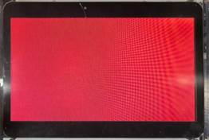 |  | 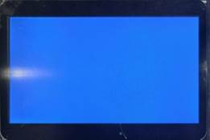 |
| 切换颜色为“White” | 切换颜色为“Black” | 切换颜色为“Yellow” |
|  | 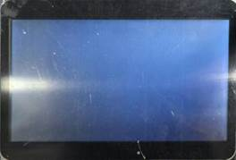 | 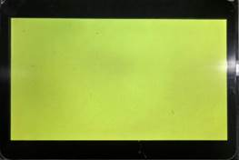 |

*图7.3.3 LCD屏幕颜色变化*

## 4．舵机控制

我们的实验箱上有一个 5 档预设角度(0°/45°/90°/135°/180°)的舵机。系统启动后，我们就可以在控制端软件上控制舵机转动了。


*图7.4.1 控制端选项*

控制端软件的选项如上图所示。我们既可以在"Servo angle"下拉框中选择 5 个常用角度，也可以点击"Servo Turn"按钮让舵机转到对应角度。

我们依次在下拉框中选择 5 个常用角度(0°/45°/90°/135°/180°)然后点击"Servo Turn"按钮，控制指令通过控制端软件发布至 Broker 服务器，随后转发至实验箱，实验箱收到指令后在终端上打印日志，并操作舵机转到对应角度。操作结果和 PuTTY 终端日志如下所示。

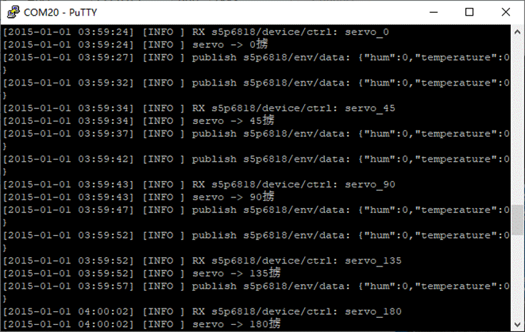

*图7.4.2 PuTTY终端日志*

| 角度调整为0° | 角度调整为45° | 角度调整为90° |
| --- | --- | --- |
|  |  |  |
| 角度调整为135° | 角度调整为180° |
|  | 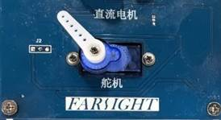 |

*图7.4.3 舵机角度变化*

# 八、总结

通过本次课设，我进一步深入了解了嵌入式 Linux 系统，并且系统性地掌握了 MQTT 协议在物联网中的应用。在调试 NFS 网络根文件系统和串口终端的过程中，我也加深了对 VMware 桥接 vs NAT 两种网络模式差异的理解，以及"实验箱从 uboot 启动到 Linux 跑起来"这一嵌入式系统引导链路的整体认知。

本次实践课程是上学期"智能硬件系统"课程的综合实践。通过本次课设，我初次独立跑通了一个完整的物联网项目、初次完整地用 Qt 编写了桌面端应用，也初次用 C 语言组织了一个跨模块、跨线程的中小型设备端项目

此前我接触过一些嵌入式和物联网项目，也接触过 MQTT 协议的 PLC 控制项目，但这是我第一次完整跑通"从传感器到控制端"全流程，也是我第一次自建 broker 并自己管理订阅与消息路由。这让我对物联网系统的端到端开发有了完整的认知——从嵌入式 C 程序设计、Qt 桌面 GUI 编程，到三方联调与协议层解耦设计，都有了第一手经验。

感谢老师在课设期间的指导，以及为这次实验做准备的幕后工作者。通过本次实验，我的能力实践经验得到了充分的历练，期待我们能在未来能与更具挑战性的课题中再次相见！

# 九、附录

## 1．程序源码

本项目已在Github开源，您可以前往 [https://github.com/LZJNano/iot_project](https://github.com/LZJNano/iot_project) 查看。由于完整源码全部塞入会占用过多页数(约 20 页)，故本附录仅精选最能体现系统设计思想的若干片段,完整代码请见上述仓库。

### 1.1. 设备端软件

#### 1.1.1. 全局配置(src/config.h)

集中管理所有”魔法值”,便于一处修改全局生效。

```cpp
/* ===== MQTT 服务器 ===== */
#ifndef MQTT_HOST
#define MQTT_HOST  "192.168.100.192"  /* VM 桥接后 IP,Mosquitto broker */
#
#define MQTT_PORT  1883
#define MQTT_KEEPALIVE 60  /* 秒 */
#define MQTT_CLIENT_ID  "fs6818_mqtt_iot" /* client id,broker 用作区分 */
#define MQTT_CLEAN_SESSION 1
/* ===== 主题 ===== */
#define TOPIC_ENV_DATA  "s5p6818/env/data" /* 上行:温湿度 */
#define TOPIC_DEV_CTRL  "s5p6818/device/ctrl"  /* 下行:控制指令 */
/* ===== DHT11 采集 ===== */
#define DHT11_DEV_PATH  "/dev/dht11"
#define DHT11_PERIOD_SEC 5  /* 采集周期,秒 */
```

#### 1.1.2. 命令分发协议(src/main.c::on_ctrl_message)

设备端收到 broker 转发的控制命令后，根据 payload 字符串分发到具体外设。

```cpp
void on_ctrl_message(const char *payload, int payload_len) {
if (!payload || payload_len <= 0) return;
/* payload 是 null-terminated 字符串 (mqtt_client.c 已保证) */
/* LED 全开/全关 */
if (!strcmp(payload, "led_on")) { led_set_all(1); return; }
if (!strcmp(payload, "led_off")) { led_set_all(0); return; }
/* LED 单控 led1_on/off ~ led4_on/off */
if (strncmp(payload, "led", 3) == 0) {
int n, on;
char action[8];
if (sscanf(payload, "led%d_%s", &n, action) == 2) {
if (n < 1 || n > LED_NUMS) return; /* led5~8 静默拒绝 */
led_set_one(n, !strcmp(action, "on"));
return;
}
}
/* 蜂鸣器(本项目应用层 OK,驱动未装,只 LOG_W) */
if (!strcmp(payload, "beep_on") || !strcmp(payload, "buzzer_on")) {
beep_on(); return;
}
/* 舵机(5 档预设 + 任意角度) */
if (strncmp(payload, "servo_", 6) == 0) {
const char *arg = payload + 6;
if  (!strcmp(arg, "0")) { servo_goto(0); return; }
else if (!strcmp(arg, "45")) { servo_goto(1); return; }
else if (!strcmp(arg, "90")) { servo_goto(2); return; }
else if (!strcmp(arg, "135")) { servo_goto(3); return; }
else if (!strcmp(arg, "180")) { servo_goto(4); return; }
else if (strncmp(arg, "angle", 5) == 0) {
int a;
if (sscanf(arg + 5, "%d", &a) == 1 && a >= 0 && a <= 180) {
servo_set_angle(a); return;
}
}
}
/* LCD 颜色(red/green/blue/white/black/yellow) */
if (strncmp(payload, "lcd_", 4) == 0) {
lcd_fill_named(payload + 4);
return;
}
}
```

#### 1.1.3. MQTT 客户端核心(src/mqtt_client.c三个回调)

设备端基于 libmosquitto 0.15 封装。3 个回调分别处理连接成功、收到消息、连接断开:

```cpp
/* 1. 连上 broker 时:订阅控制主题 */
static void on_connect(void *obj, int rc) {
if (rc == 0) {
mosquitto_subscribe(g_mosq, NULL, TOPIC_DEV_CTRL, 1); /* QoS=1 */
}
}
/* 2. 收到消息时:复制 payload 后调 on_ctrl_message 分发 */
static void on_message(void *obj, const struct mosquitto_message *msg) {
if (strcmp(msg->topic, TOPIC_DEV_CTRL) == 0) {
char *payload = malloc(msg->payloadlen + 1); /* 二进制安全 */
memcpy(payload, msg->payload, msg->payloadlen);
payload[msg->payloadlen] = '\0';  /* 加 '\0' 结尾 */
on_ctrl_message(payload, msg->payloadlen);
free(payload);
}
}
/* 3. 断线时:仅标记,重连由 libmosquitto 内部处理 */
static void on_disconnect(void *obj) {
g_connected = 0;
}
```

#### 1.1.4. DHT11 自动 mknod 关键片段(src/dht11.c)

实验箱 rootfs 的 /dev 是空目录(因为根是 NFS 挂载,没有 devtmpfs),所以 mqtt_iot 在 open 失败时主动 mknod 设备节点:

```cpp
/* 6818B 驱动写死的主次设备号 */
#define DHT11_MAJOR 804
#define DHT11_MINOR 0
static void try_mknod(void) {
struct stat st;
if (stat(DHT11_DEV_PATH, &st) == 0) return; /* 已存在就跳过 */
if (mknod(DHT11_DEV_PATH, S_IFCHR | 0666, makedev(DHT11_MAJOR, DHT11_MINOR)) != 0) {
LOG_W("mknod failed: %s", strerror(errno));
} else {
LOG_I("mknod /dev/dht11 c 804 0 ok");
}
}
int dht11_init(void) {
g_fd = open(DHT11_DEV_PATH, O_RDWR);
if (g_fd < 0) {
try_mknod();  /* 失败就尝试 mknod */
g_fd = open(DHT11_DEV_PATH, O_RDWR); /* 再开一次 */
}
/* ... 错误处理 ... */
}
```

### 1.2. 控制端软件

#### 1.2.1. 工程文件(/home/linux/Controller/Controller.pro)

qmake 工程文件,使用 Qt 4.8,无外部依赖(不依赖 libmosquitto C 库)。

```text
# ----------------------------------------------------
# Controller - IoT 课设控制端 (Qt 4.8, 兼容 Ubuntu 12.04)
# ----------------------------------------------------
QT += core gui
greaterThan(QT_MAJOR_VERSION, 4): QT += widgets
TARGET = Controller
TEMPLATE = app
SOURCES += main.cpp \
MainWindow.cpp \
MqttProcess.cpp \
FarSightWidget.cpp
HEADERS += MainWindow.h \
MqttProcess.h \
FarSightWidget.h
```

#### 1.2.2. MQTT 通信封装(/home/linux/Controller/MqttProcess.cpp)

控制端不用 QtMqtt 库,而是用 QProcess 调 mosquitto_pub / mosquitto_sub 命令行工具,Ubuntu apt install mosquitto-clients 即可。

```cpp
/* 发布:每次新建一个 QProcess 执行 mosquitto_pub,发完即结束 */
void MqttProcess::publish(const QString &subTopic, const QString &payload) {
QProcess *p = new QProcess(this);
QStringList args;
args << "-h" << m_host
<< "-p" << QString::number(m_port)
<< "-t" << (m_baseTopic + "/" + subTopic)
<< "-m" << payload;
p->start("mosquitto_pub", args);
/* fire-and-forget,完成后自动 delete */
connect(p, SIGNAL(finished(int, QProcess::ExitStatus)),
p, SLOT(deleteLater()));
}
/* 订阅:启动一个长生命周期的 mosquitto_sub 进程 */
void MqttProcess::startSubscribe() {
m_sub = new QProcess(this);
connect(m_sub, SIGNAL(readyReadStandardOutput()),
this, SLOT(onReadyRead()));
/* ... 错误处理信号槽 ... */
QStringList args;
args << "-h" << m_host
<< "-p" << QString::number(m_port)
<< "-v"  /* 打印 topic */
<< "-t" << (m_baseTopic + "/#");
m_sub->start("mosquitto_sub", args);
}
/* mosquitto_sub -v 输出格式: "topic payload" */
void MqttProcess::onReadyRead() {
QByteArray data = m_sub->readAllStandardOutput();
foreach (QByteArray line, data.split('\n')) {
line = line.trimmed();
if (line.isEmpty()) continue;
int sp = line.indexOf(' ');
QString topic  = QString::fromUtf8(line.left(sp));
QString payload = QString::fromUtf8(line.mid(sp + 1));
/* 去掉 baseTopic/ 前缀,便于上层路由 */
QString sub = topic.startsWith(m_baseTopic + "/")
? topic.mid(m_baseTopic.length() + 1)
: topic;
emit messageReceived(sub, payload);
}
}
```

#### 1.2.3. 按钮发布示例(/home/linux/Controller/MainWindow.cpp)

UI 按钮通过 sender()->property("xxx") 取出自己存的属性(如 LED 编号、LCD 颜色),拼接成命令字符串,调 m_mqtt->publish("device/ctrl", cmd) 发布。以 LCD 颜色按钮为例:

```cpp
void MainWindow::onLcdColorClicked() {
if (!m_mqtt) return;
QObject *src = sender();
QString color = src->property("lcdColor").toString();
if (color.isEmpty()) return;
m_mqtt->publish("device/ctrl", "lcd_" + color);
/* 同步更新右栏 FarSightWidget 的 LCD 叠加色,实现"所见即所得" */
if (m_farSight) m_farSight->setLcdColor(color);
}
```
