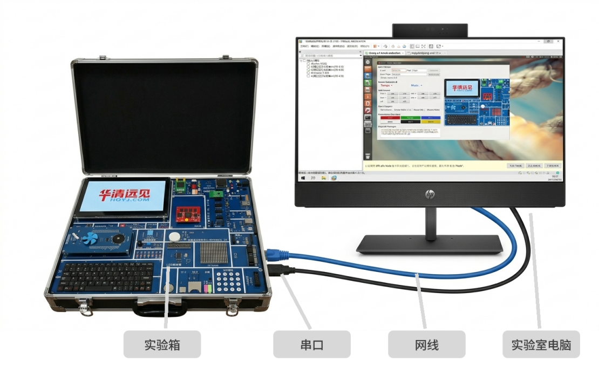
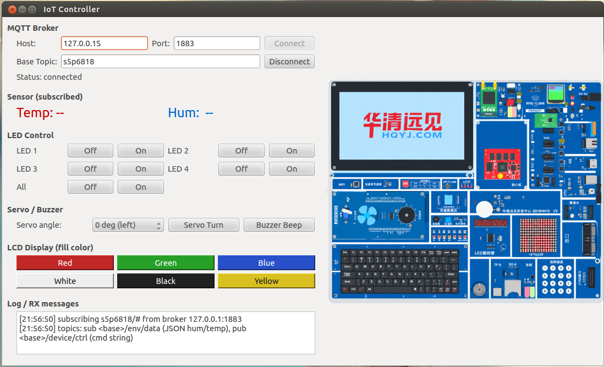
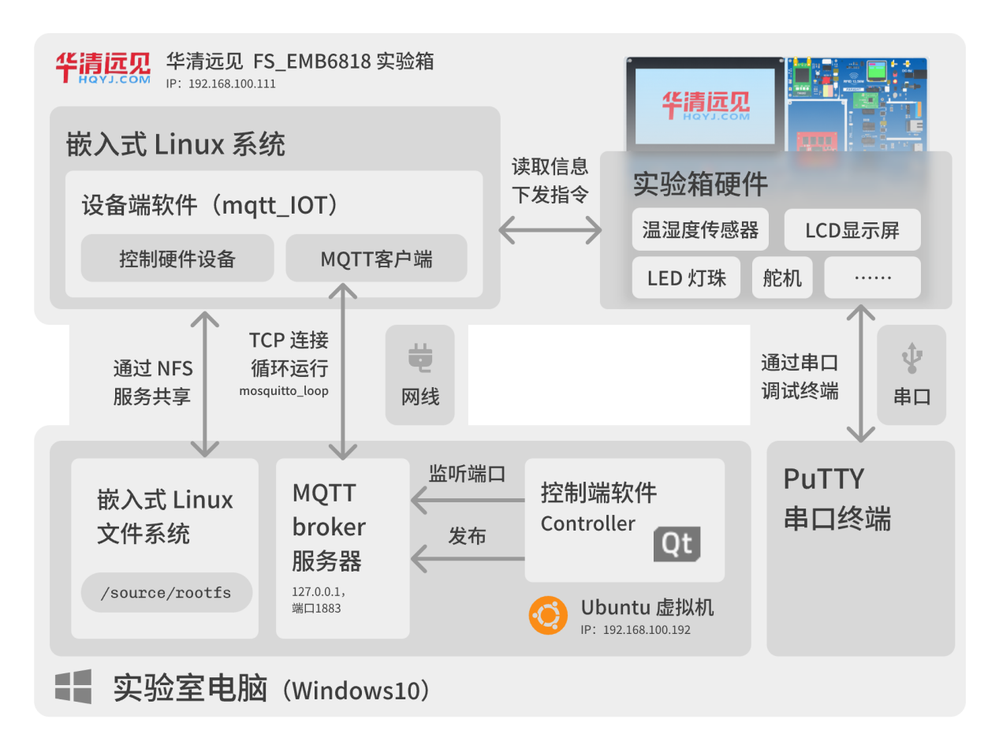
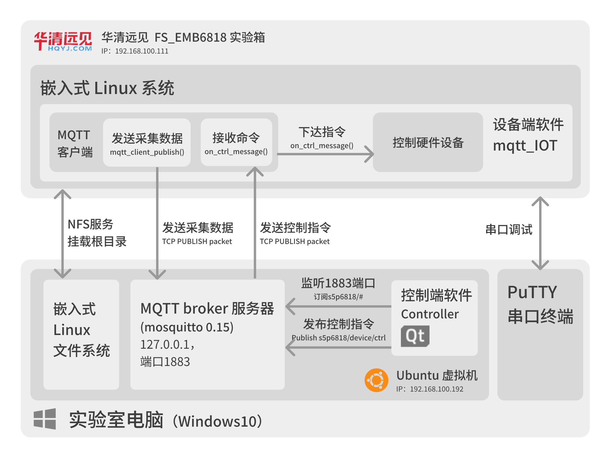
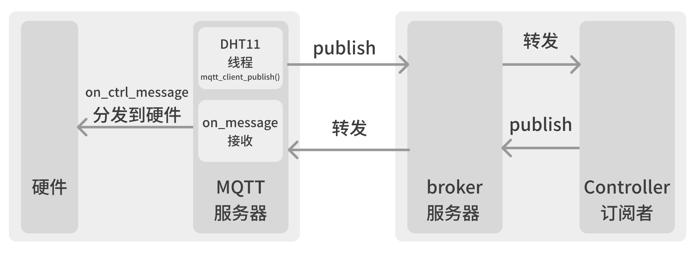

# Read Me

## 简介

这是一个“智能硬件系统课程设计”的课程设计。

在这个课程设计中一共有三个设备，分别是这台windows电脑（作为实验箱的上位机），华清远见 FS6818 实验箱（下位机），和运行在windows电脑上的Ubuntu虚拟机。

## 设备介绍
1. windows电脑
我们正在使用的就是这台 windows电脑。开发项目都在这台电脑上。这台电脑有两个网卡，一个无线网卡（能上外网），一个有线网卡（没网）。

实验箱的网线和串口都连在这台电脑上，目前端口号是COM8，波特率115200.

2. Ubuntu 虚拟机
Ubuntu 虚拟机运行在这台电脑的VMware虚拟机上。一共有两种网络模式：
2.1 NAT 模式
这时虚拟机可以使用windows电脑的无线网卡连接外网，可以上网下载东西，此时也可以通过以下命令ssh过去：
```SHELL
ssh linux@192.168.127.100
# 密码是 1
```
2.2 桥接模式
此时虚拟机被桥接到有线网卡上，无法访问外网。但是能通过有线网卡，顺着网线与实验箱进行通信。

实验箱的 Linux 系统就是挂载在虚拟机里的。启动之前需要先在uboot里设置：
```uboot
# 位于 E:\烧写镜像\linux镜像\ReadMe.txt
# NFS启动linux
setenv bootcmd ext4load mmc 2:1 0x48000000 uImage\;bootm 0x48000000
setenv bootargs root=/dev/nfs nfsroot=192.168.100.192:/source/rootfs,proto=tcp console=ttySAC0,115200 init=/linuxrc ip=192.168.100.111:::::eth0:off
```
显然，在进行这一步操作之前，需要把 Ubuntu 虚拟机的ip定死。也就是说，需要修改Ubuntu虚拟机里的 /etc/network。
```shell
linux@ubuntu64-vm:/etc/network$ cat interfaces
auto lo
iface lo inet loopback

#auto eth0
#iface eth0 inet dhcp

# '#'是注释内容，如果虚拟机需要多个网卡，则需要解除eth1的注释，否则只要按需修改eth0相关的内容即可。

auto eth0
iface eth0 inet static                                                             
#address 192.168.100.192
address 192.168.127.100
netmask 255.255.255.0
gateway 192.168.127.2
#network 192.168.100.0
network 192.168.127.0
#broadcast 192.168.100.255
broadcast 192.128.127.255
dns-nameservers 192.168.127.2

#auto eth1
#iface eth1 inet static
#address 192.168.0.192
#netmask 255.255.255.0
#gateway 192.168.0.1
#network 192.168.0.0
#broadcast 192.168.0.255
#dns-nameservers 192.168.0.1
linux@ubuntu64-vm:/etc/network$ pwd
/etc/network
```
有时光改这里还不够，还需要验证/设置网关等配置。

3. 实验箱

实验箱由华清远见制造，华清远见给了教学资料，位于 E:\，资料包括但不限于镜像源码、驱动源码、教学示例等。

实验箱采用8核cortex-A53的arm芯片，实验箱上有很多外设，比如蜂鸣器，点阵屏，温度传感器，舵机，LCD显示屏等。但 E:\程序源码\Linux驱动实验源码\设备驱动例程 给的示例有限：
```powershell
PS C:\Users\JERRY> cd E:\程序源码\Linux驱动实验源码\设备驱动例程
PS E:\程序源码\Linux驱动实验源码\设备驱动例程> ls


    目录: E:\程序源码\Linux驱动实验源码\设备驱动例程


Mode                 LastWriteTime         Length Name
----                 -------------         ------ ----
d-----         2018/8/27      8:45                fs6818_adc
d-----         2018/8/27      8:45                fs6818_gsensor
d-----         2018/8/27      8:45                fs6818_led
d-----         2018/8/27      8:45                fs6818_pwm
d-----         2018/8/27      8:45                zlg7290
d-----         2018/8/27      8:45                其它外设驱动
```

实验箱的文件目录位于虚拟机的 /source/rootfs：
```shell
linux@ubuntu64-vm:/source/rootfs$ ls
adc_log_0.txt  dev            led_test  proc            sbin  wsn6818bp_test
adc_test       etc            lib       pwm_music       sys
alarm_monitor  fs6818b_test   linuxrc   rfid_check      tmp
bin            fs6818m4_test  main      rfid_driver.ko  usr
cclib          fs_gensor      mnt       root            var
linux@ubuntu64-vm:/source/rootfs$ pwd
/source/rootfs
```
其中 fs6818b_test 和 fs6818m4_test 是外设的测试程序。

## 这个项目

这个项目是一个物联网项目，老师给的任务书位于 docs\任务书.MD。老师也给了一个参考项目，位于 docs\参考资料。

我需要做的东西如下所述：
1. 宿主机（Windows）：提供网线和串口终端给实验箱
2. Ubuntu虚拟机：启动 MQTT 客户端，订阅来自实验箱的话题，如温度信息等，也可以通过MQTT下达指令，如显示屏显示指定内容，蜂鸣器响，点阵屏显示指定字符，舵机转动等。
如果时间足够，还可以用web或者QT开发一个具有图形化界面的客户端软件。
3. 实验箱：以 Ubuntu source/rootfs 的路径启动，以arm版软件运行嵌入式程序，加载驱动，负责与底层的硬件打交道，同时接收来自Ubuntu的控制指令，并且向外传输温度信息。

## 现状（2026.10.22，已完成）

整套系统已经跑通，三个角色各司其职：

- **实验箱（设备端）**：`src/` 下的 C 程序交叉编译成 ARM 可执行文件 `mqtt_iot`。DHT11 每 5 秒采一次温湿度，以 JSON 发到 `s5p6818/env/data`；同时订阅 `s5p6818/device/ctrl` 接收控制命令并分发给外设。
- **Ubuntu 虚拟机（broker）**：跑 Mosquitto broker（192.168.100.192:1883），设备端和控制端都连它。
- **Windows（控制端）**：`Controller/` 下的 Qt 4.8 图形界面程序，左栏是温湿度实时显示和控制按钮，右栏是实验箱面板的仿真视图（点按钮右栏会同步变化）。



### 控制端界面



左栏是 MQTT 连接设置、温湿度实时读数和各类外设的控制按钮，右栏是实验箱面板的仿真视图 —— 点左边按钮，右边的 LCD、LED 会跟着变。

### 系统架构



设备端软件跑在实验箱的嵌入式 Linux 上，通过网线和 NFS 共享根文件系统；MQTT broker 跑在 Ubuntu 虚拟机里（`mosquitto_loop` 守护）；控制端是 Windows 上的 Qt 程序。三者之间用标准 MQTT 协议通信，虚拟机同时充当实验箱的根文件系统服务器。实验箱还通过串口接实验室电脑，用 PuTTY 看启动日志。



设备端的软件内部结构：`on_ctrl_message()` 把收到的 MQTT 命令分发到各外设驱动，DHT11 采集线程把温湿度发布出去。



已实现的外设控制，命令字符串直接用 `mosquitto_pub -t s5p6818/device/ctrl -m "命令"` 就能测：

| 外设 | 命令 |
|------|------|
| LED | `led_on`、`led_off`、`led1_on` ~ `led4_on`、`led1_off` ~ `led4_off` |
| 舵机 | `servo_0`、`servo_45`、`servo_90`、`servo_135`、`servo_180` |
| LCD | `lcd_red`、`lcd_green`、`lcd_blue`、`lcd_white`、`lcd_black`、`lcd_yellow` |
| 蜂鸣器 | `buzzer_on` / `beep_on`（实验箱蜂鸣器驱动未安装，应用层只记日志，不会崩） |

课程设计报告在 `docs/`，共 9 章（任务书、设备端实现、broker 端实现、控制端实现、课设效果、总结、附录）。

**上交用的报告原文**在 [`docs/智能硬件系统课设报告.htm`](docs/智能硬件系统课设报告.htm)
（Word 导出的单文件 HTML，配套图片在同名 `.files/` 目录里，浏览器直接打开即可）。
上面那些 `.md` 是原文对应的 Markdown 版本，方便在 GitHub 上直接阅读。
`docs/images/` 里是从原文中挑出来的几张图，供本 README 引用。

## 仓库结构

```
iot_project/
├── src/                  设备端 ARM C 程序（mqtt_iot）
│   ├── main.c            入口：信号处理 + MQTT + DHT11 采集线程 + 命令分发
│   ├── mqtt_client.c/h   libmosquitto 0.15 封装
│   ├── dht11.c/h         DHT11 读取（自动 mknod 建 /dev/dht11）
│   ├── led.c/h           sysfs 控制 LED
│   ├── lcd.c/h           framebuffer 填色
│   ├── servo.c/h         舵机 ioctl
│   ├── beep.c/h          蜂鸣器 ioctl
│   ├── logger.h          简易日志
│   ├── config.h          broker 地址、topic 名等集中配置
│   └── Makefile          arm-linux-gcc 交叉编译
├── Controller/           控制端 Qt 4.8 GUI（qmake 工程）
├── install/              预编译的 ARM libmosquitto.so.0 + mosquitto.h
├── docs/                 课程设计报告（9 章 Markdown + 上交用 HTML 原文 + 配图）+ 任务书 + 厂家参考资料
├── build_and_deploy.sh   设备端：交叉编译 + 部署到实验箱 NFS 根文件系统
├── build_libmosq.sh      交叉编译 libmosquitto 0.15 到 install/
└── readme.md
```

## 编译与部署

下面的命令在 **Ubuntu 虚拟机** 上执行（Windows 控制端见 `Controller/README.md`）。

```shell
# 1. 设备端：交叉编译并部署到实验箱的 NFS 根文件系统
./build_and_deploy.sh
#    交叉编译器在 /usr/local/toolchain/toolchain-4.5.1
#    部署目标 /source/rootfs/root/mqtt_iot/（实验箱 uboot 用 NFS 挂载这个根）
#    RPATH 设为 $ORIGIN，所以 libmosquitto.so.0 和主程序放同一个目录即可

# 2. broker：Ubuntu 自带 mosquitto，默认起在 1883
mosquitto -d

# 3. 手动验证
mosquitto_sub -h 192.168.100.192 -t 's5p6818/#' -v
mosquitto_pub -h 192.168.100.192 -t s5p6818/device/ctrl -m "led_on"
```

broker 地址默认写在 `src/config.h` 的 `MQTT_HOST`，也可以用命令行参数覆盖：

```shell
/source/rootfs/root/mqtt_iot/mqtt_iot 192.168.100.192
```

> 注意：实验箱的 Linux 根是 NFS 挂载的，没有 devtmpfs，所以 `/dev` 是空目录。
> `mqtt_iot` 启动时会自己 `mknod /dev/dht11 c 804 0` 建节点，不需要手动干预。

控制端的编译方法和端到端自测脚本见 `Controller/README.md`。

## 许可协议

MIT,见 [LICENSE](LICENSE)。
